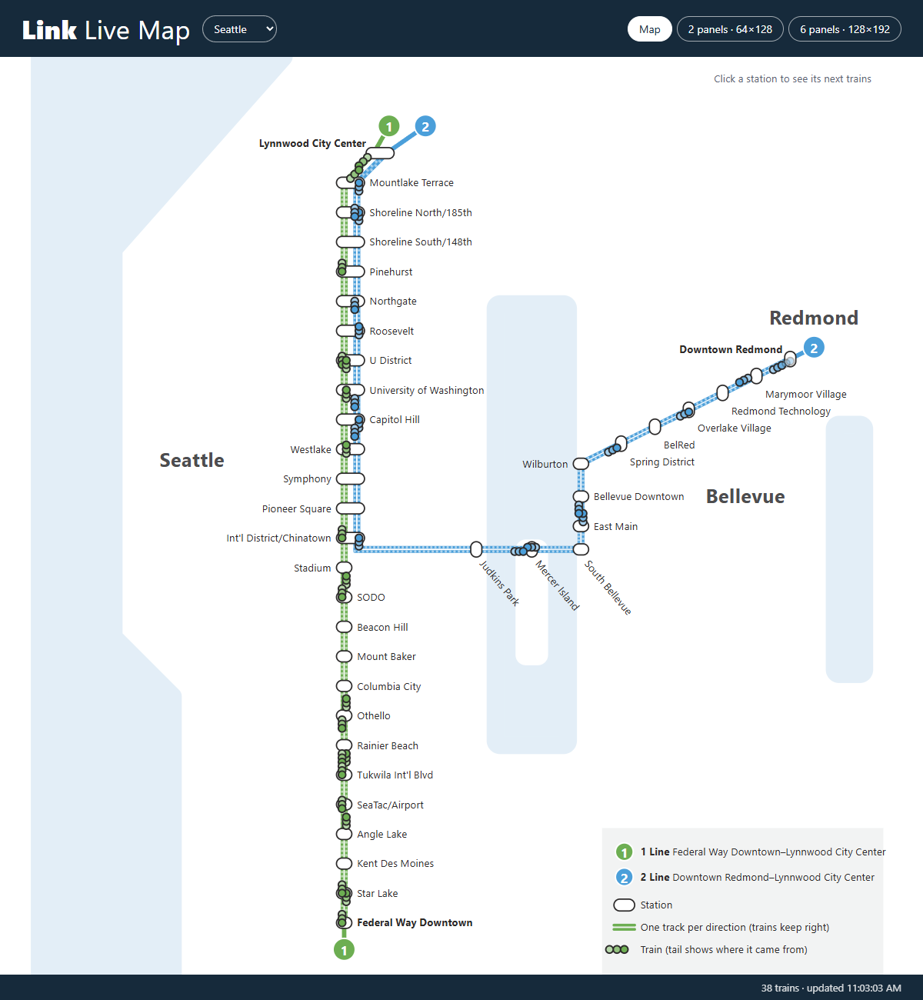
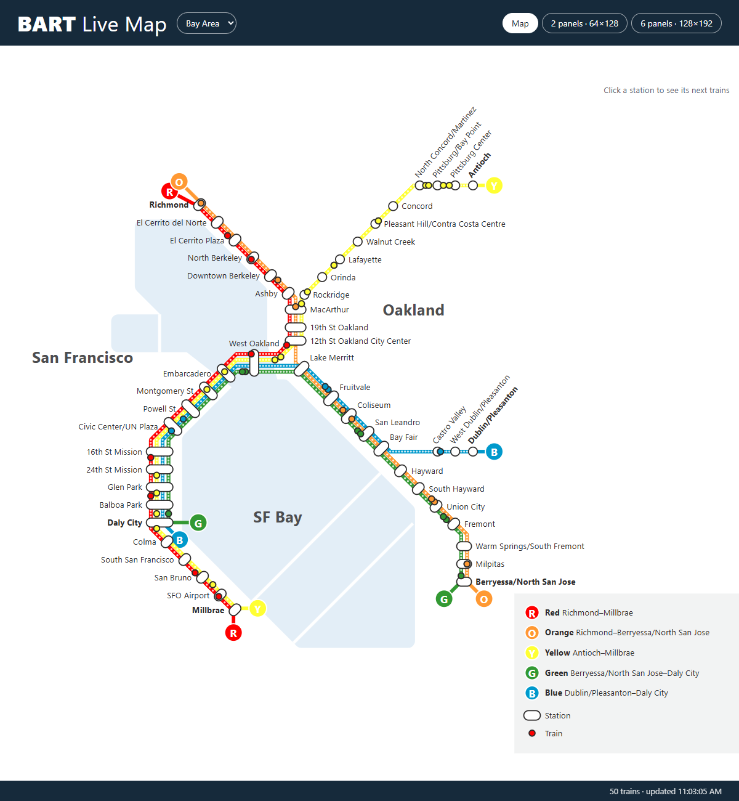
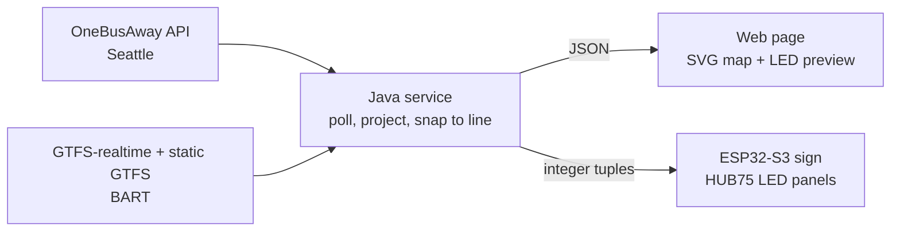

## Hi, I'm Anthony Tomlin 👋

Here's what I've been building.

---

## 🚆 link-tracker

**Live light rail maps for Seattle and the Bay Area, on the web and on a
physical LED sign.**

link-tracker follows every running Sound Transit Link and BART train in
real time. A Java service polls the agencies' live feeds and works out where
each train is on its line. A web page and an ESP32-driven wall sign of
64x64 RGB LED panels both draw the result as a transit-style schematic
diagram.

<!-- TODO: add a photo or GIF of the LED sign here -->

### What it does

- **Live trains on a schematic map.** Stations are placed like a real
  transit diagram, not at their real coordinates, so downtown stays
  readable. Each train is snapped onto its line from its real GPS position
  and drawn with a short tail showing which way it's heading.
- **Arrival boards.** Click a station to pin it and see its next trains:
  predicted times when available, and the published timetable overnight.
- **A physical LED sign.** HUB75 LED panels on an ESP32-S3 show the same
  map, trains and arrival board, in a laser-cut shadow box. It sets up over
  its own Wi-Fi hotspot, updates over the air, and goes dark when no trains
  are running.
- **More than one city.** Seattle's Link (OneBusAway, GPS positions) and BART
  (GTFS-realtime, predicted stop times only) run side by side. A new city is
  one data file and one map file.

### How it works

The server does all the hard work so the microcontroller doesn't have to.
TLS, GTFS and protobuf parsing, and the geometry all stay in Java. The sign
gets one tuple of five small integers per train over plain LAN HTTP, and
turns that into an LED with one integer formula.

### Engineering highlights

- **Correcting for stale GPS.** Each GPS fix is about 25 seconds old by the
  time it's polled, so trains were drawn about 240 m behind where they
  really were. Projecting each fix forward along the track, and never moving
  a train backwards, cut typical error from 240 m to 157 m, measured against
  12 minutes of later live fixes.
- **Positions without GPS.** BART publishes no train positions, only
  predicted arrival times. Trains are placed between stops from the
  scheduled run time left, joined to the static GTFS timetable.
- **One layout, two renderers.** The LED layout is computed once, in the web
  frontend. A script runs that same JavaScript and bakes the result into C
  headers for the firmware. CI fails if the two drift, and the firmware's
  renderer matches the web preview pixel for pixel.
- **The enclosure is generated from the same data.** A Python build reads
  the panel map and writes laser-cutter files for the facade and box,
  checking design rules like LED clearance and label overlaps.
- **Firmware built to run unattended.** A captive-portal Wi-Fi setup,
  password-protected over-the-air updates, mDNS server discovery, a task
  watchdog, and a night schedule.
- **Deliberately small.** The server is the JDK's own HTTP client and server
  plus Jackson, with no web framework. The frontend is vanilla JavaScript
  and SVG, with no build step.
- **Tested against real data.** Tests replay recorded live responses. CI
  runs them, builds every firmware variant, checks the Docker image's
  health, and publishes it to GitHub's container registry.

**Tech:** Java · JavaScript · SVG · C++ · ESP32-S3 · PlatformIO · Python ·
Docker · GitHub Actions

*The source is private. I'm happy to walk through it or demo the sign on
request.*
